# FinPing

**Personal finance for India that never leaves your phone.**

SMS and statement driven tracking of spends, cards and rewards, bills, loans, insurance, salary, provident fund and wealth. Everything is stored on the device: no account, no server, nothing uploaded.

<p align="center">
  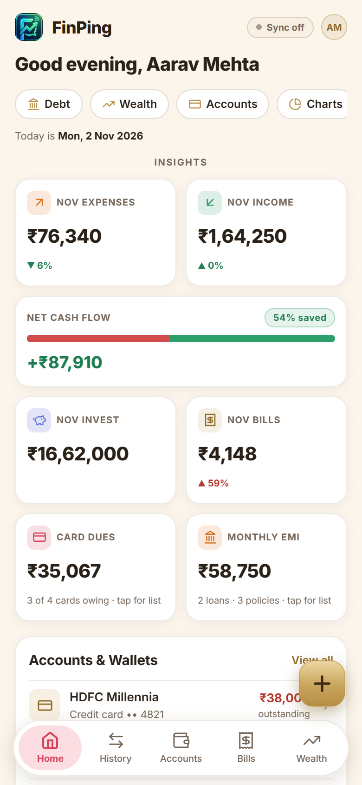 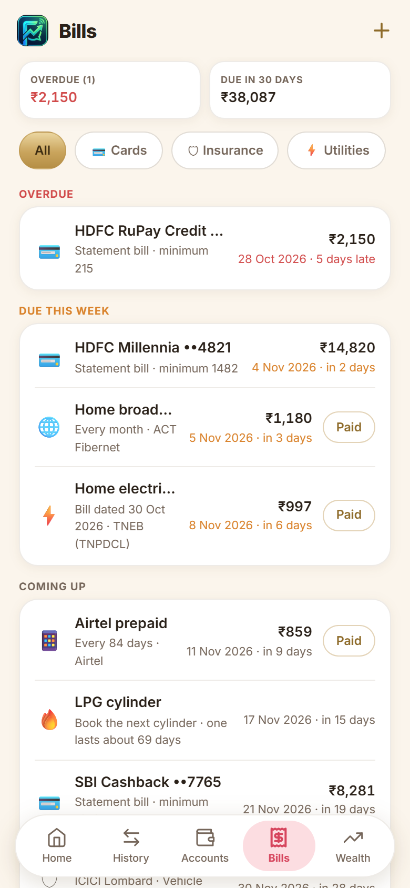 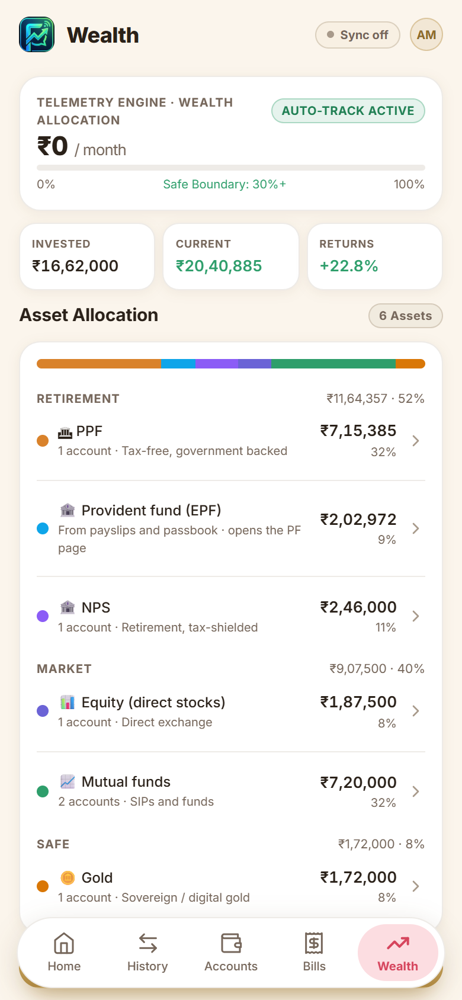 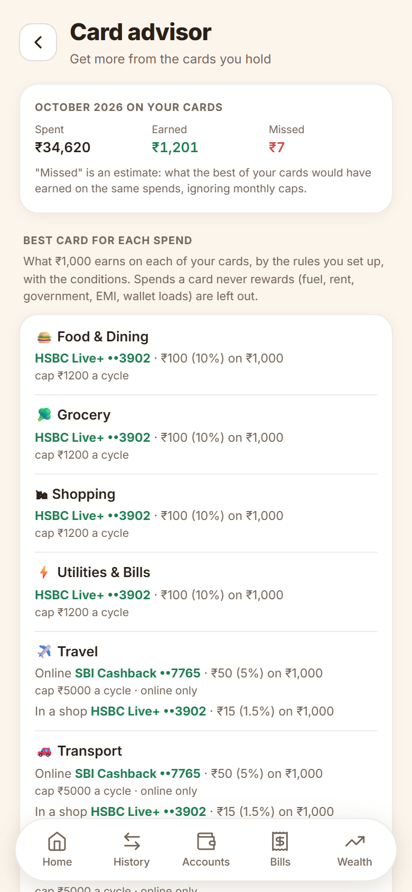
</p>

| | |
|---|---|
| **Interactive README** | Open [`docs/index.html`](docs/index.html) in a browser: search the features, flip through every screen, see the app map. |
| **Demo PDF** | [`docs/FinPing-Demo.pdf`](docs/FinPing-Demo.pdf): the features with screens and the dummy data they were taken from. |

All screenshots and the PDF use **made-up data** (a fictional person, invented cards and amounts). No real account is shown.

**Built with** React 18 · Vite 5 · Dexie (IndexedDB) · Zustand · Recharts · pdf.js · Capacitor 6 (Android) · installable offline PWA.

---

## Quick start

```bash
npm install
npm run dev        # http://localhost:5173
npm run build      # production build in dist/
npm run preview    # serve the production build
```

Android app (can read the bank SMS in your inbox):

```bash
npm run build
npx cap sync android
npx cap open android
```

---

## Features

<!-- FEATURES:START -->
### 📥 Capture

Get transactions in without typing them.

- **Bank SMS tracking.** On Android the app reads bank SMS on the phone and turns them into transactions: card spends, UPI, ATM withdrawals, credits, refunds, cashback and bill payments. OTPs, failed payments and balance-only messages are ignored. Two SMS about one payment are merged into one entry.
- **Statement import.** Bank and credit-card statements as PDF (including password-protected ones), Excel or CSV. Columns are found by themselves, Dr/Cr and C/D markers are understood, the running balance is checked line by line, and the bank's own totals are compared so you know nothing was missed. Entries you already have are matched, not doubled.
- **Manual entries.** Add an expense or income against a card or bank account. Card balances and account balances move just as an SMS would move them.
- **Link and tidy.** Link unlinked transactions to their card or account with checkboxes, or pick the account yourself when the SMS has no digits. Clean up duplicates and non-payments. Transfers between your own accounts are paired so they do not count as income or spending.
- **Categories.** A short, simple category list. Rename a category and every transaction follows. Change the category of many transactions at once. Dropdown lists (banks, networks, insurers, providers) are yours to edit.

### 💳 Cards, accounts and rewards

Every card and account, with the rewards each should have earned.

- **Credit cards.** Limit, available credit, billing cycle, due date, billed and unbilled spends, statement paid or pending, minimum due, shared limits across cards, payments you record, annual fee and fee-waiver spend. 50 popular Indian cards come bundled; a card can be added from its statement or welcome letter.
- **Debit cards and bank accounts.** Balances follow the "Avl bal" in SMS, or move with each spend or credit when the SMS has none. A debit card can be linked to its account, and "Recalculate from transactions" rebuilds a balance from the bank's last reported figure.
- **Reward rules per card.** Cashback or points, accelerated rates by category, merchant, MCC or online/in-shop, minimum spend, caps per cycle or month, exclusions (fuel, rent, government, EMI, wallet loads) and versions that start on a date, so a bank's later change never rewrites the past. Rules can be updated from the bundled library.
- **Rewards audit.** What each card should have earned in a cycle against what the bank credited, with the transactions behind any gap. A cashback summary shows credited cashback by month.
- **Card statements as bills.** Tap a card in Bills to see the open cycle and past statements: spends, payments, reward earned, cashback credited, limit used and the change from the statement before.

### 🧾 Bills

Every bill in one list: cards, electricity, mobile, broadband, gas and more.

- **One list, grouped by urgency.** Overdue, due this week, coming up and paid, with totals for overdue and the next 30 days. Filter by Cards, Insurance, Utilities, Telecom and Other. Mark a bill paid in one tap and its next due date follows.
- **Electricity tracker.** Each bill carries its own date of reading, meter reading, due date, units and amount. Units are worked out from the meter reading and the last one, or typed. See units a month, rupees a unit, the change from the bill before, and the paid date. Import the electricity board's consumption table in one paste.
- **Gas cylinder tracker.** Log when a cylinder was booked and when you started using it. The app learns how many days one lasts and tells you when to book the next.
- **Mobile, broadband and more.** Prepaid recharges by validity (28, 56 or 84 days), broadband, water, DTH and OTT, rent. Provider dropdowns hold electricity boards, gas companies, mobile and broadband operators, and anything you add.

### 📈 Wealth

What you own, grouped the way you think about it.

- **Allocation by group.** Retirement (PPF, provident fund, NPS), Market (equity, mutual funds) and Safe (gold, deposits, other), each with a subtotal and percentage. Tap an asset to see its accounts and details.
- **PPF done properly.** Log deposits, see the ₹1.5 lakh yearly limit, and get interest by the real rule (lowest balance between the 5th and month end, credited on 31 March). The current value is deposits plus interest credited, year by year, with the rate per year and the passbook figure when you have it.
- **Funds, stocks, gold, NPS.** Invested against current value, gain and percentage, entries you can edit, and the last four digits of the account number.

### 💼 Salary and provident fund

Payslips, tax and PF worked out from your own documents.

- **Salary.** Employers, CTC revisions, and one payslip per month. A payslip parser reads single payslips, registers and common layouts on the phone and stores no payslip files. Yearly gross, tax, PF and take-home totals, and a check against the credit in your bank.
- **Provident fund.** Employee and employer shares, the pension (EPS) share capped at ₹1,250 where it applies, and the rest to PF. Each employer has its own split. Interest per financial year, passbook figures from a PDF or a pasted EPFO table, and the balance after each year.

### 🏦 Debt, insurance and yearly costs

Loans, premiums and the costs that arrive once a year.

- **Loans and EMIs.** Reducing-balance loans, fixed-EMI purchases and a bank's own pasted schedule. A ledger of payments, the schedule still to come, part payments that shorten the loan, and EMIs posted on their due date.
- **Prepay what-if.** Pay extra once or every month and see the interest saved and the time cut, then compare it with investing the same money. Flexible loans such as cash credit and overdraft work from the monthly payment you choose.
- **Insurance.** Policies with insurer, type, cover, premium, frequency and next due date. Premiums count as a monthly outgo and appear in Bills when due.
- **Yearly costs.** Yearly, half-yearly and quarterly premiums, card annual fees and costs you add (car service, property tax) become one monthly amount to set aside, with how much you would have put by.

### 💡 Insights

Use the data you already have.

- **Card advisor.** The best card for each kind of spend and for brands like Swiggy or Amazon, with the conditions (minimum spend, caps, online only). UPI goes only to RuPay cards. Last month's missed rewards with the transactions, and fee-waiver progress with the spend needed each month.
- **Advisory.** Finds what you paid without choosing it: interest, late fees, over-limit, cash-advance fees, annual fees, SMS charges, forex mark-up, wallet-load fees and fuel surcharge. Each comes with how to avoid it, and lessons can be kept.
- **Charts.** Where the money went, by category and month, with filters by period and account.

### 🔒 Your data and the app

Private by design, easy to move.

- **Local only.** Everything lives in the browser's IndexedDB on your phone. No account, no server, no analytics. SMS text and statements never leave the device.
- **Backup and restore.** Export one JSON file with every table and setting, and restore it on another phone. Export reminders show how old your last backup is.
- **Android and PWA.** Runs as an installable offline web app and as an Android app (Capacitor) that can read SMS. Light and dark themes.
- **Consistent navigation.** Five tabs along the bottom (Home, History, Accounts, Bills, Wealth), a Money hub for everything else, and the same back arrow on every page you open from it. Dates are typed as dd-mm-yyyy and shown as 20 Nov 2026.
<!-- FEATURES:END -->

---

## Screens

<!-- SCREENS:START -->
| | | |
|:--:|:--:|:--:|
| <br>**Home**<br><sub>The month at a glance: spends, income, cash flow, card dues and monthly EMI.</sub> | 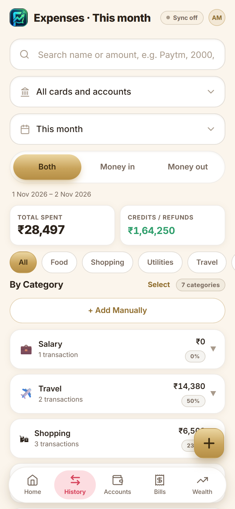<br>**History**<br><sub>Every transaction, with filters, bulk category change and reward tags.</sub> | 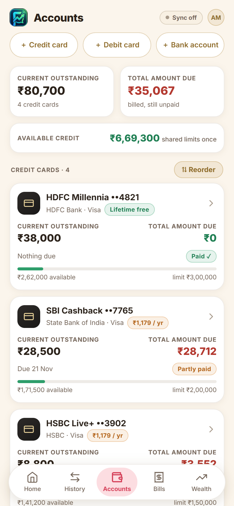<br>**Accounts**<br><sub>Credit cards with limits, dues and status, plus debit cards and bank accounts.</sub> |
| <br>**Bills**<br><sub>All bills in one list, grouped by how soon they are due.</sub> | 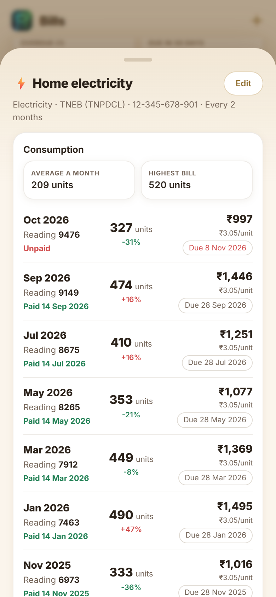<br>**Electricity bill**<br><sub>Consumption by bill: units, rate, change, due date and paid date.</sub> | 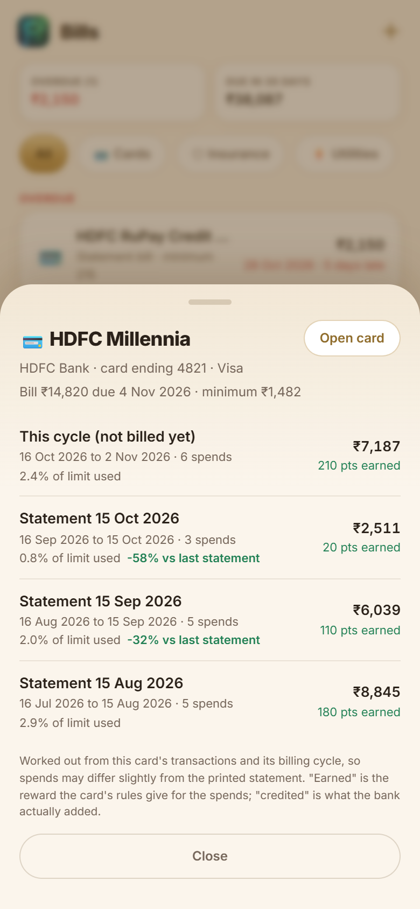<br>**Card statements**<br><sub>Past statements with spends, rewards earned and cashback credited.</sub> |
| <br>**Wealth**<br><sub>Allocation grouped into Retirement, Market and Safe.</sub> | 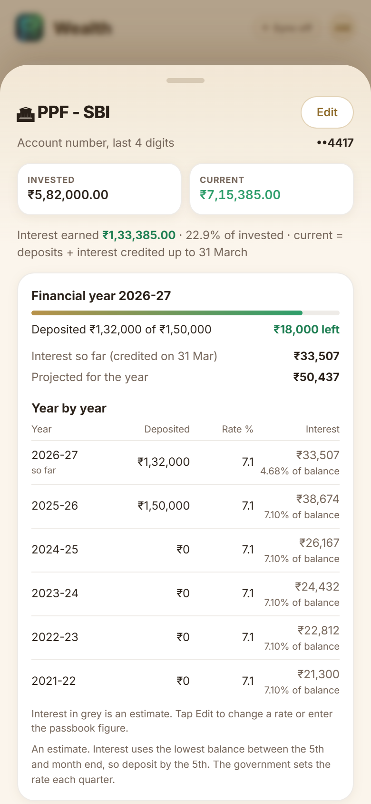<br>**PPF**<br><sub>Deposits, yearly limit and interest year by year.</sub> | 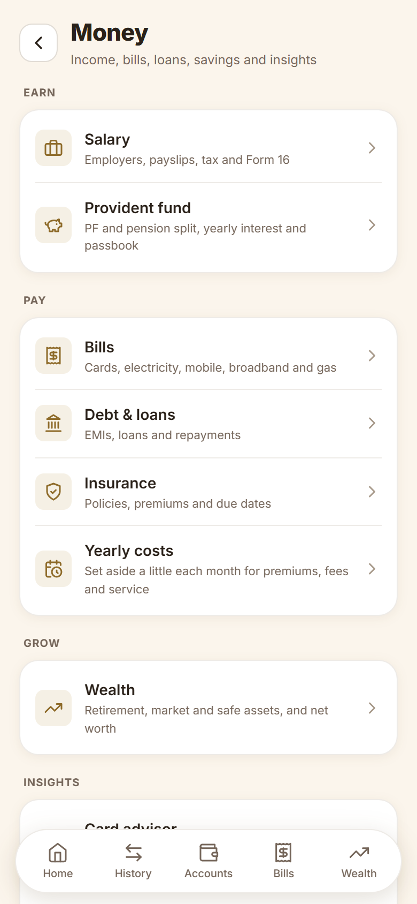<br>**Money hub**<br><sub>Earn, Pay, Grow and Insights in one place.</sub> |
| 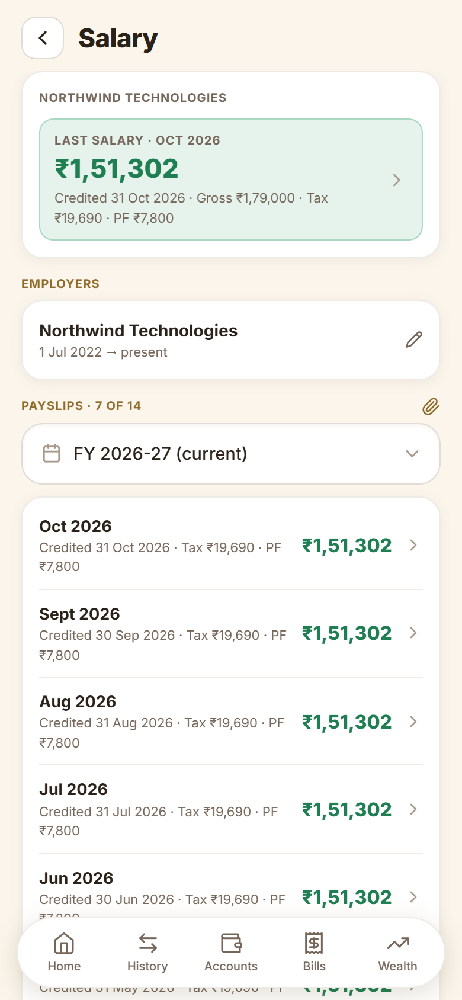<br>**Salary**<br><sub>Employers, payslips and yearly totals.</sub> | 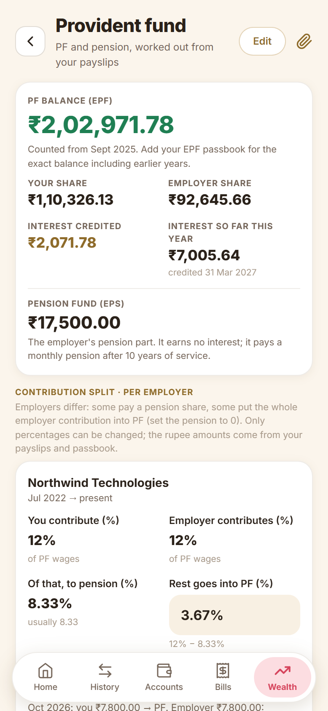<br>**Provident fund**<br><sub>Employee, employer and pension shares with yearly interest.</sub> | 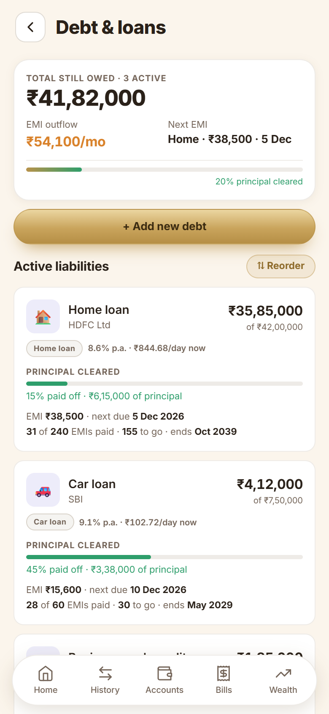<br>**Debt and loans**<br><sub>EMIs, ledger and the schedule still to come.</sub> |
| 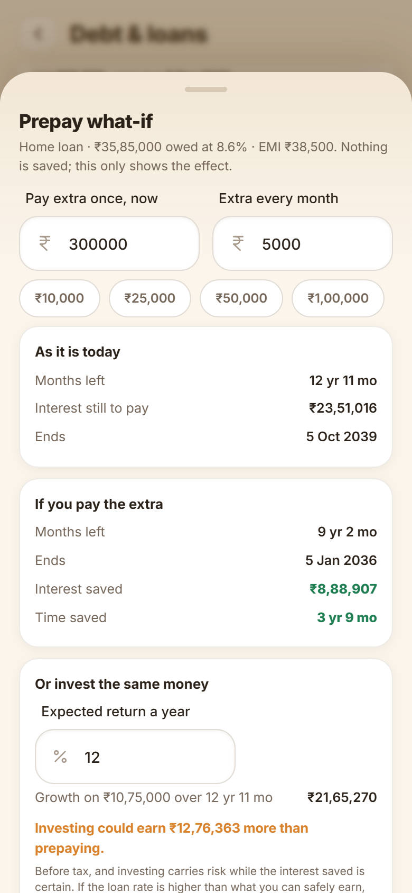<br>**Prepay what-if**<br><sub>Interest saved and time cut by paying extra, against investing it.</sub> | 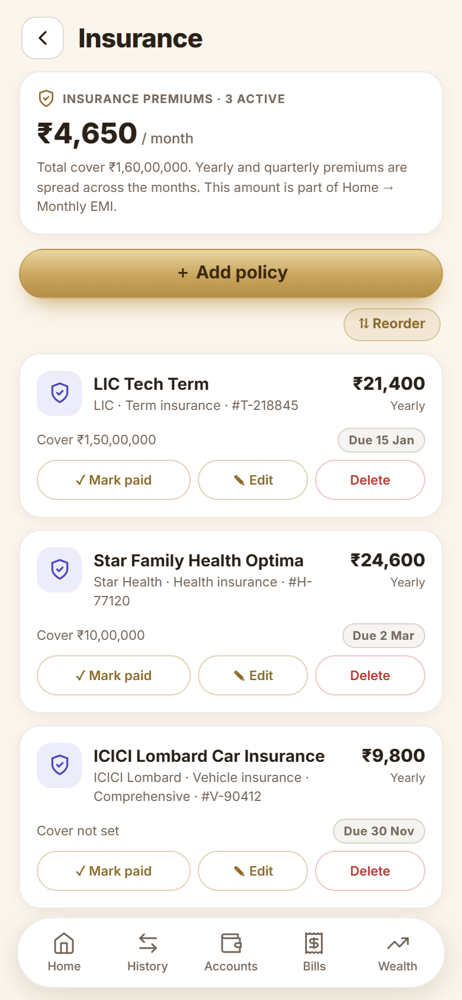<br>**Insurance**<br><sub>Policies, premiums and due dates.</sub> | 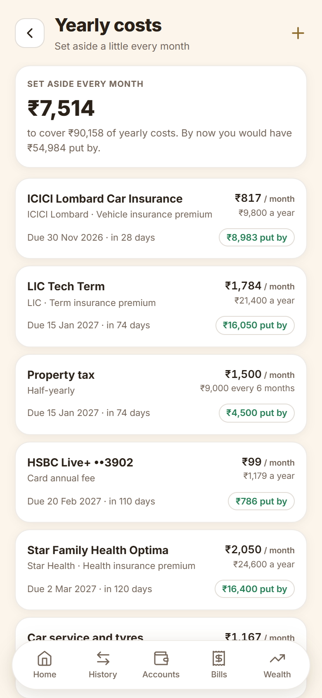<br>**Yearly costs**<br><sub>A monthly amount to set aside for yearly bills.</sub> |
| <br>**Card advisor**<br><sub>Which card to use for each spend, with the conditions.</sub> | 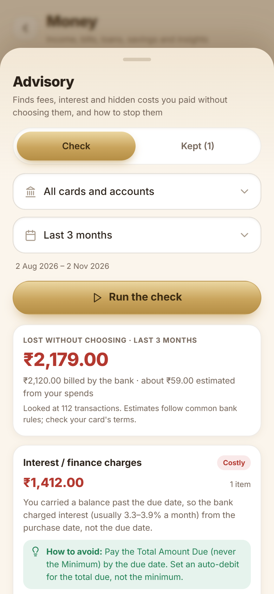<br>**Advisory**<br><sub>Hidden charges found in your transactions, and how to avoid them.</sub> | 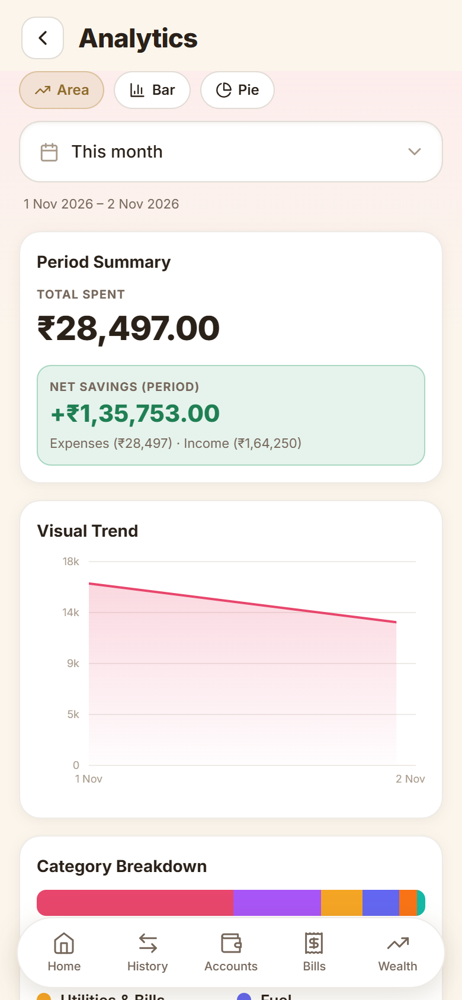<br>**Charts**<br><sub>Where the money went, by category and month.</sub> |
| 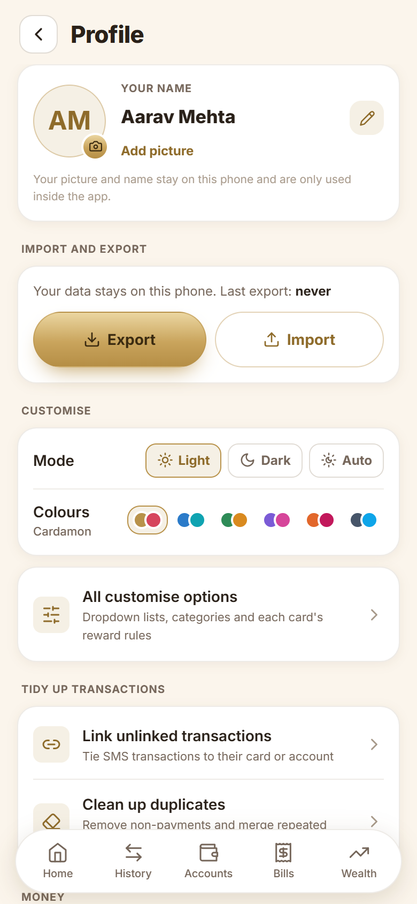<br>**Profile**<br><sub>Backup, customise, tidy-up tools and settings.</sub> |  |  |
<!-- SCREENS:END -->

---

## How it works

**Getting data in**

1. **SMS.** On Android the app reads bank SMS on the phone. In a browser, paste an SMS into History. The parser understands the common formats of HDFC, SBI, ICICI, Axis, Kotak, Yes, IDFC, AU, IndusInd, PNB, BoB, Canara, HSBC, Indian Bank and others: card spends, UPI, ATM withdrawals, credits, refunds, cashback, payments received, statement and EMI messages. OTPs and failed payments are ignored.
2. **Statements.** Import a PDF, Excel or CSV statement from the card or account page. The reader finds the table, understands Dr/Cr and C/D markers, checks the running balance, compares the bank's own totals, and matches what you already have.
3. **Manual.** Add an entry against a card or account.

**Where it lives.** One IndexedDB database in the browser (Dexie): transactions, cards and accounts, reward rules, statements, bills and their entries, investments, policies, debts, salary jobs and payslips, PF settings, and your own lists. *Profile → Import and export* writes all of it to one JSON file and restores it on another phone.

**Rewards.** A pure rules engine (`src/lib/rewardRules.js`) works out what a card should earn on each spend from the card's own rules: base rate, accelerated rates by category, merchant, MCC or channel, minimum spend, caps, exclusions and versions by effective date. The audit compares that with what the bank credited.

**Run the tests**

```bash
node --input-type=module src/lib/smsParser.test.js
```

---

## Project structure

```
src/
├── App.jsx                  # screens by name, bottom bar, back handling
├── db/schema.js             # Dexie schema (versions 1 to 14)
├── store/index.js           # Zustand: active tab, back stack, notifications
├── screens/                 # Dashboard, Expenses (History), Cards (Accounts), Debt, Wealth, Charts,
│                            # Profile, MoneyHub, Insurance, Sinking (yearly costs), CardAdvisor
├── components/              # BillsPage, CardBills, PfPage, SalaryPage, PoliciesView, PrepaySheet,
│                            # AdvisorySheet, StatementImportSheet, OptionsManager, Fields, UI ...
├── lib/                     # smsParser, ingestSMS, statement + statementPdf + statementImport,
│                            # rewardRules/rewardEngine/rewardTagging/rewardAudit, cardAdvisor, bills,
│                            # ebImport, pf, ppf, salary + payslipParser, loanSchedule, prepay,
│                            # sinking, advisory, relink, accountBalance, options, backup ...
└── data/cardRewardPresets.json   # 50 bundled cards' reward rules
docs/
├── index.html               # the interactive README (generated)
├── demo.html                # print layout for the PDF (generated)
├── FinPing-Demo.pdf         # demo PDF with dummy data (generated)
├── screens/                 # screenshots taken with the dummy data
└── tools/                   # content.mjs (the text), demo-data.js (dummy data), capture.mjs, build-docs.mjs, make-pdf.mjs
```

---

## Roadmap

<!-- ROADMAP:START -->
**Planning**

- Goals: Emergency fund (months of expenses covered), down payment and retirement corpus. Each can draw on EPF, PPF and SIPs.
- Insurance adequacy: Compare term cover with about 10 times your income from payslips, and check the health cover too.
- Retirement projection: EPF, PPF and NPS growth to the age you pick.

**Ask and remind**

- Ask in plain words: A search bar that answers "how much on Swiggy in October?" from your own data.
- Due-date calendar and reminders: A next-30-days view and phone notifications before every due date.
- Data health screen: Unlinked transactions, stale balances, cards without a cycle and bills without a due date, each with a fix button.

**Money care**

- Tax and 80C summary: Provident fund, PPF, insurance and payslips totalled for the year, with Form 16 checked against payslips.
- Recurring charges: Spot subscriptions and SIPs in your transactions and offer them as bills.
- Net worth over time: Assets less liabilities, saved every month as a trend.
- Mutual fund statement import: One CAS statement fills in your funds, units and value.
- Nested categories and budgets: Sub-categories with a monthly budget for each.
- Safer data: Weekly backup reminder, share to Drive, and an optional PIN or fingerprint lock.
<!-- ROADMAP:END -->

---

## Rebuilding the docs

The feature text lives in `docs/tools/content.mjs`; the screenshots come from the app running on made-up data.

```bash
npm i --no-save puppeteer-core                   # a browser driver; uses your installed Chrome or Edge
npm run dev                                      # in another terminal
node docs/tools/capture.mjs http://localhost:5173   # retake the screenshots
node docs/tools/build-docs.mjs                   # rebuild index.html, demo.html and the lists above
node docs/tools/make-pdf.mjs                     # rebuild docs/FinPing-Demo.pdf
```

## Notes

- **Reward rules are yours to confirm.** The bundled rules follow each card's published terms at the time they were added, and banks change them. Check the card's current terms, and edit or version the rule on the card.
- **Dependencies.** `npm audit` reports issues in the build tooling (Capacitor CLI, the Vite/esbuild dev server, the PWA build chain) and React Router. Fixing them means major-version upgrades, which are pending.
- **Privacy.** There is no analytics and no network call for your data. Backups are plain JSON files; keep them somewhere safe.
